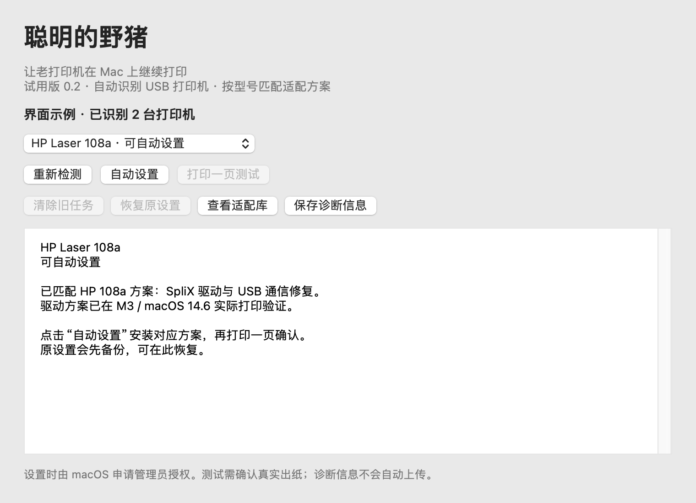

# 聪明的野猪 · SmartBoar

让老打印机在 Mac 上继续打印。

面向 **Apple Silicon Mac** 的开源打印机助手：自动识别 USB 设备，按完整型号匹配驱动和修复方案，在修改前备份原设置。普通用户下载安装包即可使用，无需终端命令、Homebrew 或 Python。

**0.2.0 是试用版。当前只有 HP Laser 108a 可自动设置；另外 10 个候选机型仅有识别记录。新版安装包尚未完成实际安装和真实出纸验证，也未经过 Developer ID 签名与 Apple 公证。**

[下载安装包](https://github.com/cmdyzh-cyber/SmartBoar/releases/tag/v0.2.0) · [安装与使用](docs/安装与使用.md) · [常见问题](docs/常见问题.md) · [报告问题](https://github.com/cmdyzh-cyber/SmartBoar/issues/new/choose)

## 下载和使用

1. 在版本页面的 **Assets** 下载 `SmartBoar-0.2.0-arm64-unsigned.pkg`。Source code 和源码 ZIP 不是安装程序。
2. 接上打印机 USB，打开电源并放好纸。双击 PKG，按 macOS 提示授权安装。
3. 从“应用程序”打开“聪明的野猪”。如果只有一台已适配设备且没有旧任务，安装阶段会尝试自动设置；否则在窗口中选择设备，再点击“自动设置”。
4. 点击“打印一页测试”，确认完整打印一页、没有重复出纸。

安装程序不会自动打印，也不会取消旧任务。未签名的软件下载后可能被系统拦截，请先阅读[安装与使用](docs/安装与使用.md)。不需要关闭 SIP 或全局关闭安全检查。

系统要求：M1、M2、M3 或更新 Apple 芯片，macOS 14 或更高版本。当前真实设备证据来自 M3 / macOS Sonoma 14.6，不代表所有后续系统均已实测。Windows、Intel Mac、无线打印、扫描和传真暂不支持。

## 当前机型状态

| 状态 | 机型 | 行为 |
|---|---|---|
| 可自动设置 | HP Laser 108a，USB `03F0:E82A`，完整 USB 产品名 `HP Laser 108a` | 匹配 SpliX 驱动与限定 USB 修复 |
| 已有识别条目，Mac 适配待验证 | Samsung ML-1510、ML-1610、ML-1660、ML-2010、SCX-4200、SCX-4300 | 显示型号，不安装驱动 |
| 已有识别条目，Mac 适配待验证 | Xerox Phaser 3117、3160；Dell 1100、1110 | 显示型号，不安装驱动 |
| 尚无适配方案 | 其他可读取的标准 USB 打印机类设备 | 显示信息，可保存诊断，不猜测安装其他型号驱动 |

同一 HP 108a 驱动与设备修复方案已在 M3 / macOS 14.6 真实出纸，USB 重新插拔后也完整打印一页、没有重复。这是机型方案的证据，**不等于 0.2.0 安装包已完成真实安装验证**。新版已通过原生编译、隔离配置与回滚测试、安装包和界面检查，详见[验证与发布](docs/验证与发布.md)。

候选机型来自 [SpliX 上游列表](https://openprinting.github.io/splix/)。上游报告可用不代表本项目已完成 Mac 实测。部分使用厂商自定义 USB 接口的设备可能暂时无法识别。

## 界面



截图中的两台设备是界面演示，不代表实际检测结果。

## 修改与恢复

只处理选中设备精确对应的 USB 队列，不改变默认打印机。HP 108a 保留 SpliX 和 macOS 原生 USB backend，只处理该设备的 IPP-over-USB 桥接与接口，不全局关闭 USB/IPP 服务，不关闭 SIP。

原配置在修改前备份，重复设置保留首次备份；失败时尝试恢复本次操作前状态。“恢复原设置”恢复首次备份，新建队列会撤销。恢复后应用和未使用驱动仍留在系统中，恢复不是完整卸载。

新建队列显示“聪明的野猪 · 实际机型”，已有名称保留。有旧任务时停止设置；清理只针对所选队列。机内已经接收的数据可能需要打印机关机再开机才能清除。

## 隐私和限制

“保存诊断信息”仅保存本地文件，不自动上传；内容含系统版本、USB 厂商/产品标识、产品名和匹配状态，不含序列号、设备哈希、队列 URI、用户名或本地路径。公开 Issue 的附件对外可见，提交前自行检查。

0.2.0 的适配库内置，随版本更新。**没有在线驱动下载，也不会自动生成任意打印机的驱动。** 型号不匹配、规则冲突、身份重复、缺失序列号或有多个对应队列时不会自动设置。

## 项目由来

最初是一台 HP Laser 108a 在 M3 MacBook 上能被识别，却一打印就脱机。排查后发现，仅安装驱动还不够，还需处理 USB 通信模式和 QPDL 纸张尺寸。修复后将方案整理成安装器，再拆分成可扩展的机型库和驱动模块。

希望让更多老打印机继续使用。支持范围按照真实设备验证逐步增加，不把 Linux 或 Windows 驱动列表直接当成 Mac 支持名单。

## 开发与贡献

原生 AppKit 应用、Foundation 管理器、IOKit USB 扫描；规则在 `resources/catalog.json`，驱动模块与队列管理分离。

在 Apple Silicon Mac 准备 Xcode Command Line Tools 和开发用 Python 3：

```sh
bash build.sh
python3 tests/integration_checks.py
pkgutil --expand-full release/SmartBoar-0.2.0-arm64-unsigned.pkg build/release-expanded
python3 tests/package_checks.py
```

Python 不随软件安装。默认构建未签名 PKG，程序只有临时签名。驱动对应源码在 `vendor/SpliX-fixed-source.tar.gz`，随项目和安装包提供；解压后进入 `splix-build`，用 `make DISABLE_JBIG=1` 重建，开发库搜索路径可能需按环境调整。

[贡献指南](CONTRIBUTING.md) · [增加机型](docs/增加机型.md) · [开发与架构](docs/开发与架构.md) · [更新记录](CHANGELOG.md)

## 许可与致谢

原创应用、管理器和 USB 工具采用 [MIT](LICENSE)。SpliX、PPD 和第三方补丁保留上游许可，整个分发包不能统一视为 MIT；见 [THIRD_PARTY.txt](THIRD_PARTY.txt) 和 [SpliX GPL 文本](vendor/COPYING-SpliX.txt)。

感谢 [photovirus/splix-macos](https://github.com/photovirus/splix-macos)、[OpenPrinting/SpliX](https://github.com/OpenPrinting/splix) 和 [Kuberwastaken/hp-laser-1008a-macos](https://github.com/Kuberwastaken/hp-laser-1008a-macos)。对应代码、补丁和版权声明继续适用，完整修改后的驱动源码随包提供。

项目不包含专有 HP 驱动，不隶属于 HP、Apple 或其他打印机厂商。按对应开源许可提供，不承诺所有老打印机都可用。
